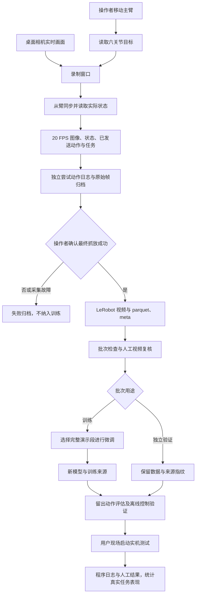

# 项目结构与数据链路说明

本项目研究桌面单相机条件下，使用 SO-101 主从双臂示范训练 SmolVLA 完成红色方块抓取放置。机械臂控制、训练数据采集和论文材料同属一个毕业设计项目。

## 目录与职责

仓库对应本机 `D:\FYP\毕业设计项目\机械臂控制项目`。其同级的 `训练数据采集/` 与 `毕业论文资料/` 不属于独立项目。

| 位置 | 内容 |
|---|---|
| `README.md` | 项目入口与三份核心文档链接 |
| `文档/开发文档.md` | 最新开发、历史版本、后续优化方向 |
| `脚本/项目控制台.bat`、`入口清单.json` | 统一可见操作，打开后不自动开始硬件任务 |
| `脚本/数据采集/` | 采集指引、录制入口与实现、尝试归档、采集检查、视频恢复和软件自检 |
| `脚本/日常操作/` | 采集训练面板、相机、同步、模型抓取和人工结果入口 |
| `脚本/离线实验/` | 训练、留出评估、数据检查和离线控制验证入口 |
| `脚本/检查工具/`、`环境配置/` | 只读检查、软件验证与环境配置 |
| `脚本/程序模块/` | 共享 Python 模块及训练、评估、控制实现 |
| `脚本/历史工具/`、`旧视觉方案/`、`历史版本/` | 旧方案、兼容入口与历史原文 |
| `上游框架/` | 固定 LeRobot 源码与第三方接口 |
| `模型/`、`运行环境/`、`标定备份/` | 本机模型、环境/缓存和标定；不上传 GitHub |
| `运行记录/` | 原始运行日志与完整软件报告，仅留本机 |
| `文档/项目进展/` | 可提交的进展、指标与验证摘要 |
| `../训练数据采集/机械臂控制项目/任务演示/` | 本机原始演示与采集尝试，视频/状态/动作同批保存 |

自建脚本用中文用途命名，统一在 `脚本/` 下。固定框架和数据接口如 `meta`、`data`、`videos`、`config.json` 与 `model.safetensors` 保留原名。移动脚本须同步检查控制台、面板、批处理和导入；原始迁移记录留在 FYP 的 `公共工具/整理记录/`。

## 数据从哪里来，到哪里去



相机按设备名 `1080P USB Camera` 打开，640×480 MJPEG 25 FPS 采集；数据保存为 20 FPS，六关节遥操作循环目标 60 Hz。`1080P` 是设备名称，不是当前录制分辨率。现在主线使用桌面单相机，双路摄像头问题尚未解决。

录制不调用 SmolVLA。操作者通过主臂示范，`observation.state` 来自从臂实际关节读数，`action` 来自实际发送给从臂的目标。六关节顺序固定：

`shoulder_pan.pos, shoulder_lift.pos, elbow_flex.pos, wrist_flex.pos, wrist_roll.pos, gripper.pos`

数值使用 LeRobot SO101 标定单位：主体通常 -100～100、夹爪 0～100，不能当作角度。每帧保存名义时间 `frame_index/20`，动作日志另保存相机、状态、发送动作的实际相对时间，帮助检查同步与时效。

## 一批演示包含什么

```text
单相机演示_时间/
  采集配置.json                 任务、用途、设备、频率、关节顺序和程序指纹
  meta/                         LeRobot 段数、任务、统计
  data/chunk-*/episode_*.parquet 六关节状态、动作、索引与时间戳
  videos/chunk-*/.../*.mp4       对应桌面视频
  第001段逐帧时间.json           已保存段的实际采集时间
  采集尝试/尝试_独立编号/
    尝试状态.json                场景、类型、状态、人工确认及归档信息
    动作与状态.jsonl             逐帧动作、状态、图片位置和实际时间
    原始帧/frame_*.png           保存/拒绝/失败前保留的原始图片
  批次封存状态.json              只在归档、保存或清理异常时出现
```

`recording → pending → saved` 是人工确认后成功写盘的流程。`rejected` 是操作者重录，`failed/interrupted` 是采集中断，`save_failed` 是保存异常。这些状态不能互相替代。独立尝试编号与 LeRobot 段号分别管理，多个失败尝试可以对应同一个尚未保存的段号。

归档失败时保留原文件，禁止清理和继续写入。保存中途上游可能已经修改缓冲或写入部分表格，因此异常批次封存，重新打开窗口使用新目录。恢复视频只能恢复视觉证据，不能凭图片补造缺失动作或认定可训练。旧失败批次不会被自动删除或修复。

## 训练、评估与部署

采集训练面板只手动启动录制窗口；软件任务选择演示段、生成训练计划、训练新目录并检查来源。标记为独立验证或已封存的批次不得训练。旧数据没有新标签时保留兼容，需人工判断用途。

模型输入是桌面图像、六关节状态和任务文字，输出动作块。训练统计与检查点绑定，演示动作/状态与视频保存内容指纹，避免复制或重命名后被误认为独立验证。

当前训练实现预载视频到内存；扩充数据后先估算占用，并推进受限缓存。3 段小批次的验证不能代表 30 段扩充后的吞吐与内存表现。

离线动作误差评估、模拟机械臂目标发送和真实抓取成功率是不同证据。实机入口先预热，等待操作者开始，以实时相机/状态异步生成动作；故障、过期输入和停扭矩未确认均进入停止流程。真实成功需用户观察并绑定日志记录，不能仅凭脚本退出成功推断。

## 如何继续

采集操作见 [同目录数据采集指引](../脚本/数据采集/数据采集指引.md)。开发维护见 [开发文档](开发文档.md)。历史指标和详细日志摘要见 [项目进展](项目进展/当前进展.md)。

GitHub 分支保存可复现的软件和文档。模型、标定、训练原始数据和人员可见的视频仅在本机保存，协作者另行配置本地数据与环境。
