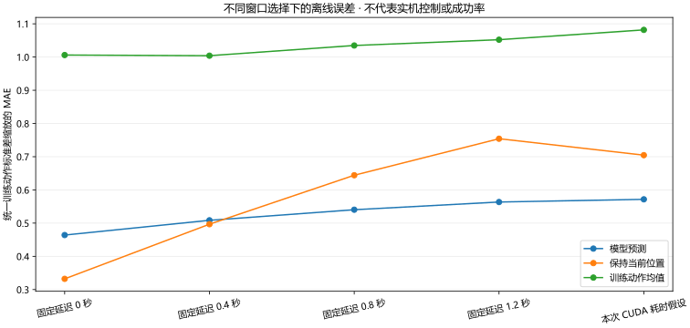

# 执行窗口假设下的离线误差

这是示范数据上的原始目标误差分析，不是实机动作回放或任务成功率。

模型 `模型/整段留出实验模型`，20 Hz，每块最多选择 20 步。从 floor(延迟×频率) 开始，假设后续控制节拍恰好推进一步，期间没有新结果替换。

| 情形 | 有效目标步数 | 过期窗口 | 模型误差 | 保持当前位置 | 训练动作均值 |
|---|---:|---:|---:|---:|---:|
| 固定延迟 0 秒 | 180 | 0 | 0.4641 | 0.3323 | 1.0060 |
| 固定延迟 0.4 秒 | 180 | 0 | 0.5085 | 0.4968 | 1.0041 |
| 固定延迟 0.8 秒 | 180 | 0 | 0.5404 | 0.6442 | 1.0348 |
| 固定延迟 1.2 秒 | 180 | 0 | 0.5635 | 0.7541 | 1.0522 |
| 固定延迟 2.5 秒 | 0 | 9 | 不计算 | 不计算 | 不计算 |
| 本次 CUDA 推理耗时假设 | 160 | 1 | 0.5716 | 0.7046 | 1.0818 |

误差统一按训练段动作标准差缩放；统计按有效目标步数加权。延迟变化会选择不同的未来示范动作，不能用曲线下降推断增加延迟会改善控制。

## 腕部旋转关节

| 情形 | 模型 MAE | 保持当前位置 MAE |
|---|---:|---:|
| 固定延迟 0 秒 | 3.884 | 1.666 |
| 固定延迟 0.4 秒 | 4.662 | 3.117 |
| 固定延迟 0.8 秒 | 5.781 | 4.600 |
| 固定延迟 1.2 秒 | 6.948 | 5.693 |
| 固定延迟 2.5 秒 | 不计算 | 不计算 |
| 本次 CUDA 推理耗时假设 | 6.509 | 5.248 |

这里的关节 MAE 为 LeRobot 归一化位置单位，不是角度。

## 适用范围

- 按示范状态与未来示范动作比较原始目标，未模拟反馈、限幅、接触或物理轨迹。
- 真实入口发现整块过期会停止；这里独立分析各采样窗口，不代表过期后继续真实控制。
- 每种情形假设控制节拍不丢步，最多执行指定步数，且期间没有新结果替换动作块。
- CUDA 推理耗时只计模型调用，不含相机帧龄、预处理、线程等待或主线程接收延迟。
- 过期窗口不记作零误差；统计按有效目标步数加权，窗口可能重叠，非独立任务试验。
- 模型与对照使用同一索引和尺度，不能把误差降低解释为实机任务成功。

离线预测来源日期：2026-10-07T01:37:04。分析器本身只读取缓存，没有再次执行模型。
