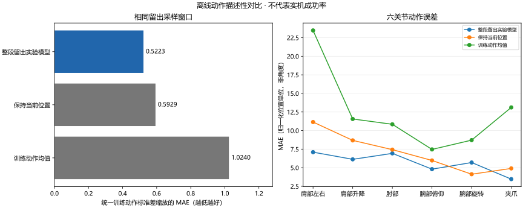

# 留出动作与简单对照

复用已有留出推理结果，仅比较离线动作误差；不代表实机抓取成功率。

统一尺度取自 `模型/整段留出实验模型` 的训练段动作标准差。动作块长度 50，共 9 个窗口；各行使用相同窗口。每块覆盖 2.50 秒预测。

| 方法 | 统一尺度平均误差 ↓ | 六关节原单位平均误差 ↓ | 相对保持当前位置 |
|---|---:|---:|---:|
| 整段留出实验模型 | 0.5223 | 5.6868 | 0.88 倍 |
| 保持当前位置 | 0.5929 | 7.0433 | — |
| 训练动作均值 | 1.0240 | 12.5272 | — |

| 方法 | 肩部左右 | 肩部升降 | 肘部 | 腕部俯仰 | 腕部旋转 | 夹爪 |
|---|---:|---:|---:|---:|---:|---:|
| 整段留出实验模型 | 7.093 | 6.128 | 6.931 | 4.806 | 5.698 | 3.464 |
| 保持当前位置 | 11.146 | 8.677 | 7.431 | 5.975 | 4.125 | 4.906 |
| 训练动作均值 | 23.473 | 11.559 | 10.843 | 7.461 | 8.712 | 13.115 |

单位为 LeRobot 归一化位置单位，身体 RANGE_M100_100、夹爪 RANGE_0_100，不能当作角度。

“保持当前位置”将窗口起点的六关节状态重复作为所有目标；“训练动作均值”只使用训练段统计。两者均不读取验证窗口未来动作来构造预测，也不会发送机械臂命令。

## 限制

- 窗口可能重叠且来自同一演示，不能把窗口当作独立任务试验。
- 当前只复用已保存模型误差，不重新执行模型或真实机械臂。
- 旧评估未记录推理配置和统计文件指纹；各模型自己的标准差缩放指标不能直接跨模型比较。
- 比较完整预测动作块，不能代表异步控制跳过过期步骤后的实际执行窗口。
- 保持当前位置对照只预测动作；既不执行动作，也不证明静止可完成抓取。

当前模型的验证段与训练段来自同一采集批次；仍需独立新批次与人工记录实机结果。

部分窗口可能重叠；不计算统计显著性或把误差差异解释为任务成功率提升。
